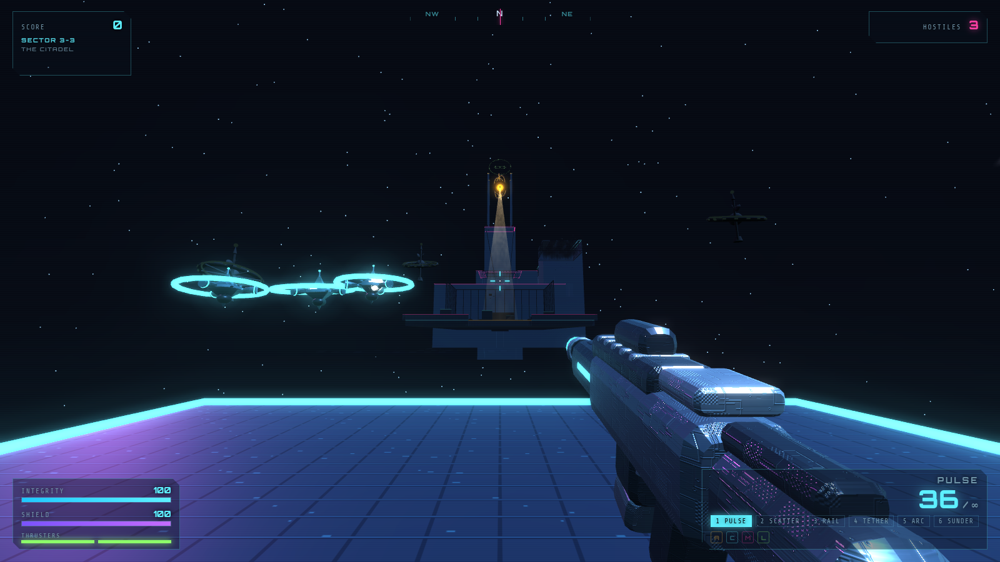
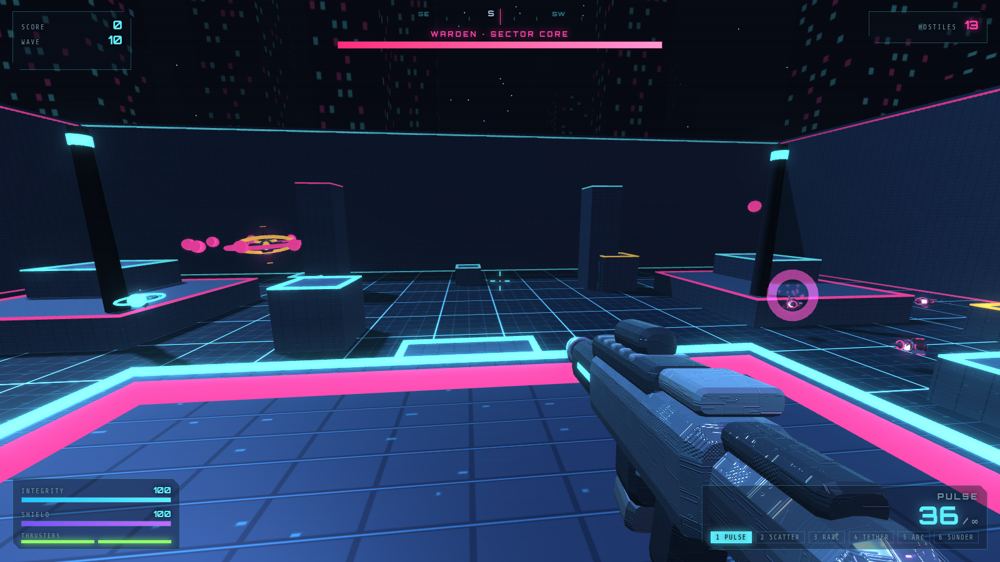

# Neon Breach

A fast single-player sci-fi shooter that runs in the browser, built on Three.js.
Fight through a twelve-level campaign, from the foundry's transit lines to the
citadel and the eye that keeps it locked down, or hold out in the endless arena.
Quake-style movement with double jumps and dash thrusters, six weapons that are
as much tools as guns, and bosses that need working out.

**[Play it in your browser](https://barrycohen.github.io/neon_breach/)** (desktop,
keyboard and mouse)





Vibe coded with Claude Opus 5.5.

## Controls

| Action | Default |
| --- | --- |
| Move | `W` `A` `S` `D` |
| Jump / double jump | `Space` |
| Dash | `Shift` |
| Fire | Left mouse |
| Weapons | `1`–`6`, mouse wheel, right mouse or `Q` |
| Reload | `R` |
| Pause | `Esc` |

Every key can be rebound from **Configure controls** on the start screen, which
also has an ESDF layout.

## Run it locally

The game is plain ES modules with nothing to install. It has to be served
rather than opened from disk:

```
python3 tools/serve.py          # then open http://127.0.0.1:8099
```

Run from source, the game is in development mode, with tools for testing
changes:

- **F2** opens a dev panel: teleport to any checkpoint, key, door or core, god
  mode, one-shot kills, and every key and weapon.
- `#level=act2-1` in the URL jumps straight to a level.
- `#unlock` opens every level in the campaign picker.
- `#debug` exposes the game's internals on `window` for scripted tests.

The built game leaves all of this out.

## Build

```
python3 build.py
```

This bundles the game into `dist/`: a single `index.html` with the scripts
(Three.js included), styles and levels inlined, plus the optional 3D models. `.github/workflows/pages.yml`
runs it and publishes `dist/` to GitHub Pages on every push to `main`.

## How it's made

- `js/` holds the game: rendering, movement, weapons, enemies and the level
  runtime. Textures, models and sound are all generated in code; `assets/` only
  holds a few optional glTF models.
- `vendor/three/` is [Three.js](https://threejs.org) r128 and the add-ons the
  game uses (bloom, glTF loading), under Three.js's own MIT license.
- `levels/` holds the level definitions as JSON. The campaign sectors are
  generated by the scripts in `tools/` (`gen-act1-1.py` writes
  `levels/act1-1.json`, and so on); the three tutorials are written by hand.
- `tools/check-levels.py` checks every level before it ships: that each key,
  door and goal can be reached in order, and that no floors have gaps or
  surfaces flicker.

## License

MIT - see [LICENSE](LICENSE).
